<div align="center">

<picture>
  <source media="(max-width: 600px) and (prefers-color-scheme: dark)" srcset="docs/brand/readme-banner-dark-mobile.svg">
  <source media="(max-width: 600px)" srcset="docs/brand/readme-banner-light-mobile.svg">
  <source media="(prefers-color-scheme: dark)" srcset="docs/brand/readme-banner-dark.svg">
  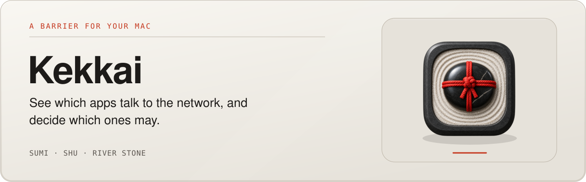
</picture>

<picture>
  <source media="(max-width: 600px) and (prefers-color-scheme: dark)" srcset="docs/brand/readme-showcase-dark-mobile.svg">
  <source media="(max-width: 600px)" srcset="docs/brand/readme-showcase-light-mobile.svg">
  <source media="(prefers-color-scheme: dark)" srcset="docs/brand/readme-showcase-dark.svg">
  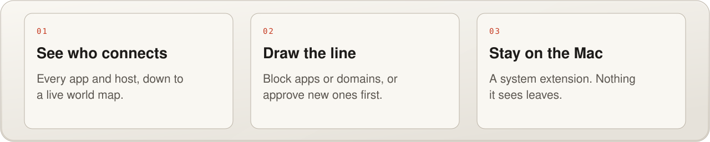
</picture>

<br><br>


# Kekkai · 結界

**A barrier for your Mac.**

In a Japanese garden, a small stone tied with a cord sits on a path: *sekimori-ishi*, the
barrier stone. Nobody locks the gate; the stone simply says "not past here", and everyone
understands. Kekkai (結界, a sacred boundary) brings that to your Mac's network. It shows
which apps connect where, down to the host, the country and the bytes. Block an app or a
domain with one click, or have new apps wait at the stone until you decide. It is a native
app with a Network Extension content filter underneath, and nothing it sees leaves your Mac.


<table>
<tr>
<td align="center"><b>4</b><br><sub>modes</sub></td>
<td align="center"><b>3</b><br><sub>ways to name a host: system, SNI, DNS</sub></td>
<td align="center"><b>5</b><br><sub>views: apps, destinations, activity, map, rules</sub></td>
<td align="center"><b>30</b><br><sub>days of history, on this Mac</sub></td>
<td align="center"><b>0</b><br><sub>map tiles, servers, trackers</sub></td>
</tr>
</table>

</div>

<br>

<picture>
  <source media="(prefers-color-scheme: dark)" srcset="docs/screenshots/map-dark.webp">
  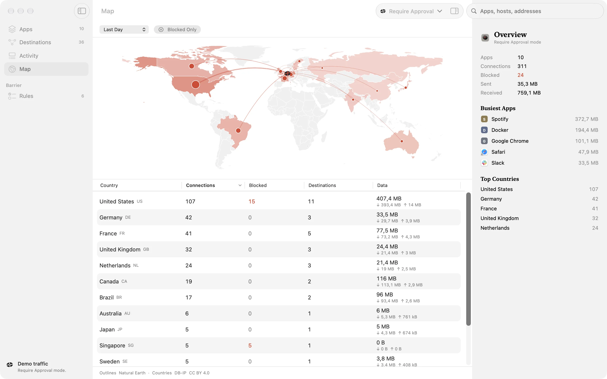
</picture>

<p align="center"><sub>Where your Mac talks to, drawn on the Mac itself. All screenshots use Kekkai's built-in demo traffic.</sub></p>

---

## What it does

**Four modes.**
- **Block List**: enforces your rules and lets everything else through.
- **Require Approval**: holds new apps at the barrier until you answer.
- **Allow All**: lets every connection through and keeps watching.
- **Block All**: drops every connection except loopback, with Apple software and DNS
  lookups as switchable exceptions, so macOS can still resolve names and update.

**Rules that hold.** Per-app rules are keyed on the code signature: team ID plus signing
identifier. Apple software is keyed by identifier alone; unsigned or ad-hoc code by its path,
so a copied identifier never inherits another app's rule. The Allow List and Block List take
domains, wildcards (`*.example.com`) and IP addresses, pasted in bulk. Blocking `example.com`
covers every subdomain, and the Block List always wins.

**Hostnames, even when apps hide them.** Kekkai uses the system's hostname when there is one.
Otherwise it reads the TLS server name (SNI) from the first bytes an app sends, which covers
browsers using DNS over HTTPS, and joins a handshake split over several packets back together.
It also reads DNS answers, so a connection to a bare address still shows the name the app
looked up. QUIC with a hidden hostname is dropped while you have blocked domains, so browsers
fall back to TLS, where the name is readable.

**An approval panel that stays out of the way.** A floating glass panel that doesn't take
focus from what you're doing: the app, its signature, path, hosts, addresses, countries,
ports, what the developer declared it connects to (its Internet Access Policy), and a
countdown. Allow with ⌘↩, block with ⌘⌫, or answer from the notification.

**Everything, in context.** Apps, Destinations and Activity are searchable tables with time
ranges (5 minutes to 30 days), Blocked Only, expandable rows and an inspector per app: rule,
signature (signer, team, certificate chain, notarisation, hardened runtime), location and
destinations. Every verdict comes with its reason. The map is drawn from Natural Earth
outlines on your Mac, with no tiles fetched from anywhere.

**Watch mode, no extension needed.** When the filter isn't running, Kekkai still lists your
real connections, read from macOS's own `nettop`, with no admin password. It can't block them
there, and destinations show as IP addresses instead of hostnames; connections to addresses
blocked through the System Firewall show as Blocked.

**A barrier even without the extension.** When the filter isn't running, the System Firewall
section in Rules applies your Block List to macOS itself: addresses through a `pf` anchor
under Apple's own `com.apple/*` rules, so `pf.conf` is never edited, and domains through a
marked block in `/etc/hosts`, with a one-time backup. Every apply or remove asks for your
admin password and nothing stays running as root. When your Block List and what this Mac
enforces drift apart, a floating bar says so, with Apply… and Review; it also notices when a
restart cleared the address blocks. In Rules, what works without the filter comes first: the
System Firewall and the lists, with modes, exceptions and app decisions folded into Filter
Settings. Verified live on a real Mac: applying loaded the anchor and its table, a blocked
domain resolved to `0.0.0.0` and a blocked address refused connections; removing put both back.

**Block one app, even without the filter.** In Watch mode, the inspector, the right-click menu
and ⌘↵ in the palette offer *Block App on This Mac…*. It blocks, through `pf` and one password
prompt, the addresses only that app has used; addresses other apps share stay open. New ones
are added as Watch mode sees them, offered through the same Apply bar, and Unblock removes
exactly what was added. It is an approximation: an exact per-app block needs the filter.

**Starts where you are.** A build that can't load the filter (no developer team) opens on two
honest choices: Watch your Mac, or Block on this Mac with the System Firewall. In the toolbar
one status pill (Watching, Barrier down, or the mode) holds every control in a popover: mode,
raise or lower the barrier, the Watch toggle and the System Firewall. The status mark is the
icon's own stone, and raising the barrier sends one vermilion ripple out from it.

**A welcome that shows, then asks.** On first launch a short welcome opens in its own window.
It shows your own Mac live from Watch mode (the apps talking and how much), then asks how to
protect it: just watch, block on this Mac with the System Firewall, or the network filter in a
signed build. It walks through the three ways to block (the inspector, ⌘K and the lists), sets
the menu bar, login and notifications, and applies your choice. Help > Welcome to Kekkai, or
Settings > General > Show Again, brings it back.

**And the rest of a proper Mac app.** A menu bar extra with status, mode, a live traffic chart,
apps waiting for you and Recently Blocked. Settings for login, notifications, the QUIC rule,
the approval timeout, and rule import and export as JSON. An About window with the exact build.
An Uninstall command that removes the filter and the extension before moving the app to the
Trash.

<table>
<tr>
<td width="50%">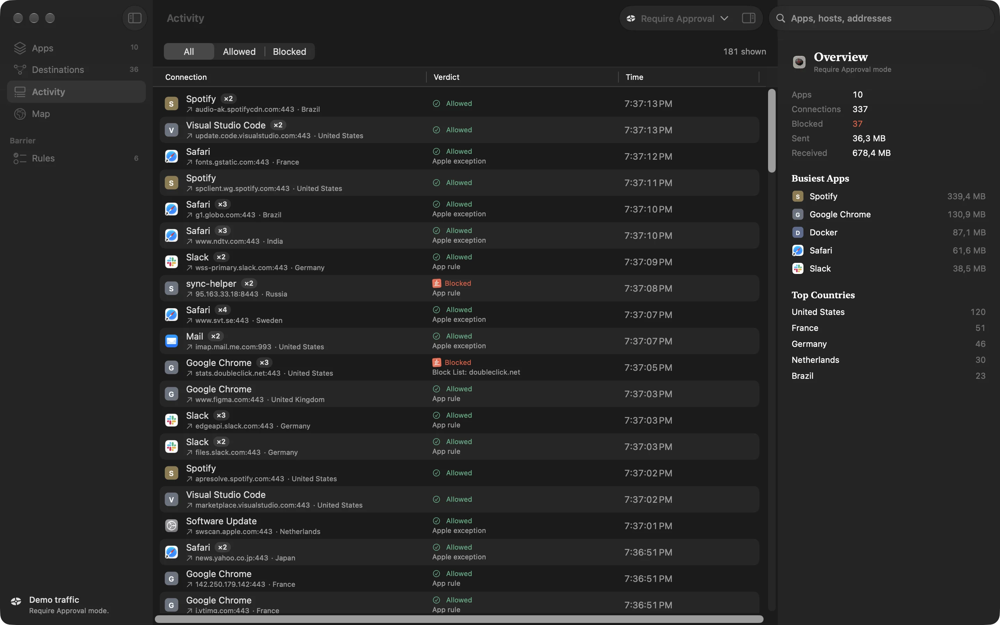<br><sub>Activity: every connection, its verdict and the reason.</sub></td>
<td width="50%">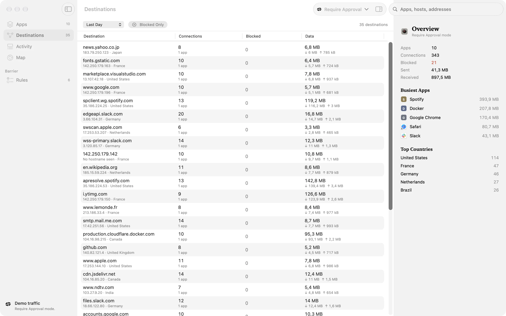<br><sub>Destinations: every host, with what it cost.</sub></td>
</tr>
<tr>
<td width="50%">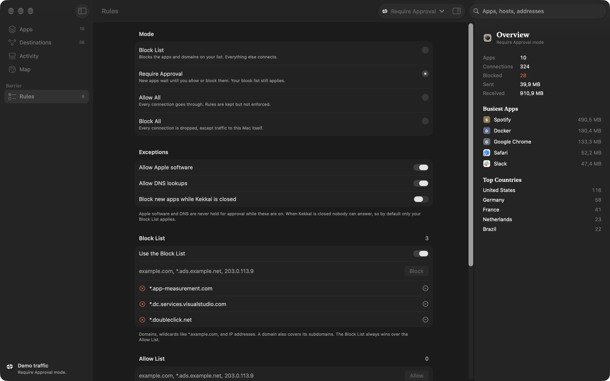<br><sub>Rules: modes, exceptions, the Block List and Allow List.</sub></td>
<td width="50%">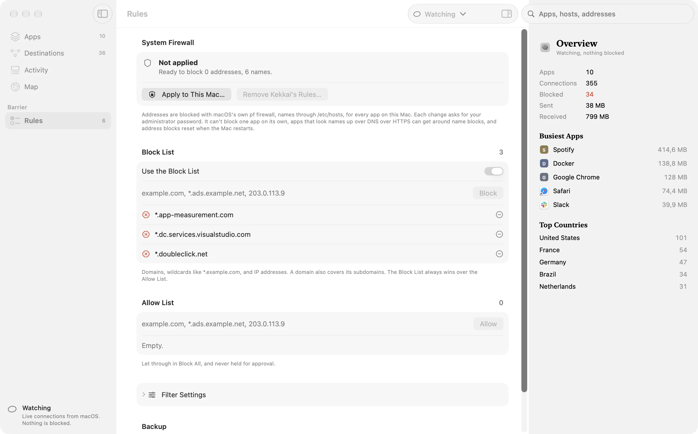<br><sub>No extension? The System Firewall applies your Block List to macOS.</sub></td>
</tr>
<tr>
<td width="50%">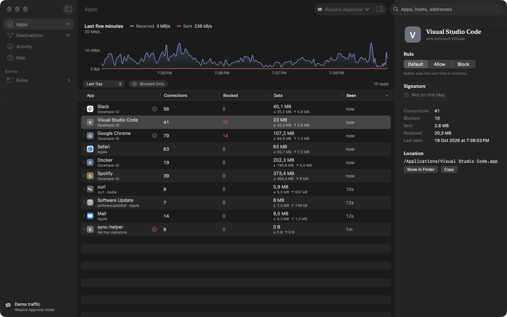<br><sub>Apps: each one with its rule, signature and traffic.</sub></td>
<td width="50%">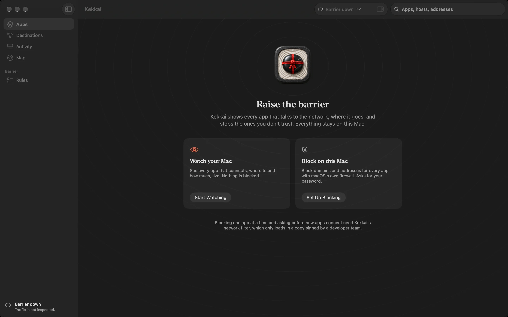<br><sub>First launch: watch, or block with macOS itself.</sub></td>
</tr>
<tr>
<td width="50%">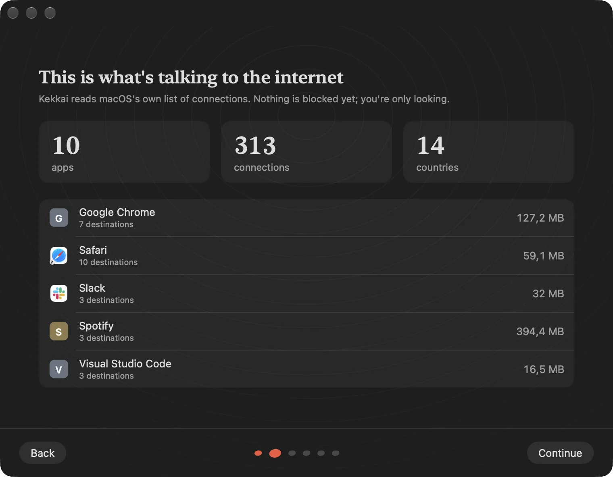<br><sub>The welcome starts with what your Mac is already doing.</sub></td>
<td width="50%">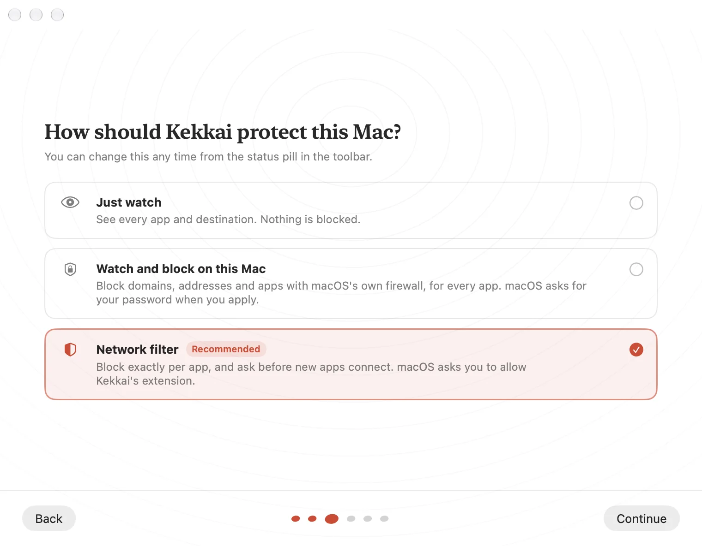<br><sub>Then it asks how far to go.</sub></td>
</tr>
</table>

## How it works

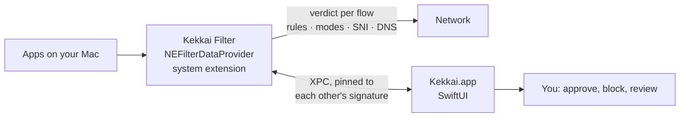

| Path | What |
|---|---|
| `Shared/` | Rule engine, SNI and DNS parsers, GeoIP table, XPC contract, System Firewall plan (both targets) |
| `Extension/` | The `NEFilterDataProvider` system extension: verdicts, pause and resume for approval, rule storage, XPC listener |
| `App/` | The SwiftUI app: windows, panes, map, approval panel, menu bar, settings, About, updater, demo data |
| `Tests/main.swift` | Checks: rules, SNI on a real curl ClientHello and split deliveries, DNS, QUIC rule, rule migration, GeoIP, System Firewall |
| `scripts/` | `check.sh`, `fetch-geoip.sh`, `fetch-map.sh`, `release.sh`, `install.sh`, `make-dmg.sh`, `make-pkg.sh`, `make-art.swift`, `make-icon.swift` |

The app and the extension only talk to each other: each checks the other's code signature on
the XPC connection. Kekkai never overwrites another content filter's configuration.

## Get started

### Install

Download [the latest release](https://github.com/mostlygino/Kekkai/releases/latest) (0.1.0 beta)
in the form you like:

- **`Kekkai-0.1.0.dmg`**: a raked-gravel garden, the stone in its rings on the left and
  Applications on the right, a vermilion knotted cord between them. Drag to install.
- **`Kekkai-0.1.0.pkg`**: a guided installer with a welcome page, the AGPL licence and a closing
  page with first steps. It installs to `/Applications`.

Each file has a `.sig` from the release key. The builds are ad hoc and not notarised, so the
filter is off and macOS asks once: right-click the app, then Open. Watch mode, the System
Firewall and demo mode all work.

### Build

```sh
brew install xcodegen
scripts/fetch-geoip.sh    # country data into App/Resources/geoip.bin (not committed)
scripts/check.sh          # logic checks
xcodegen generate
DEVELOPER_DIR=/Applications/Xcode.app/Contents/Developer \
  xcodebuild -project Kekkai.xcodeproj -scheme Kekkai -derivedDataPath build \
  CODE_SIGNING_ALLOWED=NO build
```

See it with demo traffic, no extension needed:

```sh
open -n build/Build/Products/Debug/Kekkai.app --args -demo
# -demoPane apps|destinations|activity|map|rules   -demoAppearance light|dark
# -demoTour (every pane, dark then light)   -demoOffline (Watch mode and the System Firewall)
# -demoWelcome [-demoWelcomeStep 0-5] (the first-run welcome)
```

### Filtering for real

Loading the content filter needs a signing team:

1. Use a paid Apple Developer team with the **Network Extensions** and **System Extension**
   capabilities.
2. Set `DEVELOPMENT_TEAM` in `project.yml`. Developer ID builds use the entitlement value
   `content-filter-provider-systemextension`; Apple Development builds use
   `content-filter-provider`.
3. Install the app in `/Applications`, choose **Raise Barrier**, and allow the extension in
   System Settings, under General, Login Items & Extensions.

A Mac managed through MDM may refuse a personal system extension.

## Updates

Kekkai updates itself from this repository's GitHub releases and verifies every download
against a pinned release key before installing, so GnuPG is needed for the check
(`brew install gnupg`). It reads releases through GitHub's public API over HTTPS; with the `gh`
CLI installed it uses that instead, which also covers private forks. The app holds no token.

Releases are cut with `scripts/release.sh <version> [--beta]`: with `KEKKAI_TEAM` set the build
is signed and the filter can load; without it, the build is ad hoc and runs the app, demo mode
and updates, but not the filter. Each release ships three ways in, all signed with the release
key: a drag-to-install DMG on raked gravel (`scripts/make-dmg.sh`), a guided installer package
with welcome, licence and closing pages (`scripts/make-pkg.sh`), and the zip the updater uses.
`scripts/make-art.swift` draws all of the installer artwork. The first release, 0.1.0, is out as
a beta; see the [changelog](CHANGELOG.md).

## Status and known limits

Kekkai is a 0.1 beta. The app, demo mode, the logic checks and the System Firewall are
verified on macOS 26; the filter extension has not yet run live, because loading it needs the
signing team above.

- Not yet verified on a live filter: flow byte counts read as running totals, and a paused
  flow resumed with a data-filter verdict still getting callbacks.
- With Encrypted Client Hello, Kekkai sees the public outer name instead of the real host.
- Require Approval needs Kekkai open to answer. When it is closed, the Block List applies, so
  your Mac stays online; a setting blocks new apps instead, if you prefer.
- The System Firewall is system-wide (`pf` can't tell apps apart, so per-app blocks are by
  address only), DNS over HTTPS skips its name blocks, and its address blocks reset at reboot
  (Kekkai notices and offers to apply them again).
- "Block all of example.com" takes the last two labels, which is wrong for suffixes such as
  `co.uk`; it is offered next to the exact host, not instead of it.

## Contributing

Bug reports, ideas and pull requests are welcome. [CONTRIBUTING](CONTRIBUTING.md) covers the
build, the checks, the demo flags and how the code is laid out; the
[code of conduct](CODE_OF_CONDUCT.md) applies everywhere. Found a security problem? Please
report it privately, as [SECURITY](SECURITY.md) describes, not in an issue. Every release is in
the [changelog](CHANGELOG.md).

## Licence

Code: AGPL-3.0-or-later ([LICENSE](LICENSE)). Name, icon and artwork: all rights reserved, see [BRAND.md](BRAND.md).

## Read more

- [Design](DESIGN.md): "Garden, restrained": the tied stone, the 止 seal for blocked verdicts, the one vermilion
- [Product](PRODUCT.md): who Kekkai is for and the rules it keeps
- [Brand](docs/brand/README.md): the sekimori-ishi icon, rendered rather than drawn

---

<div align="center">


<sub>Map outlines: <a href="https://www.naturalearthdata.com">Natural Earth</a>, public domain. IP to country: <a href="https://db-ip.com">DB-IP</a> IP to Country Lite, CC BY 4.0.<br>
Inspired by the category (Little Snitch, LuLu, TinyShield); the name, code, copy and artwork are its own.<br>
Code under AGPL-3.0-or-later; name, icon and artwork reserved. See <a href="#licence">Licence</a>.</sub>

</div>

<br>

<a href="https://mostlygino.com">
  <picture>
    <source media="(max-width: 600px) and (prefers-color-scheme: dark)" srcset="https://raw.githubusercontent.com/mostlygino/mostlygino/main/assets/signoff/built-with-love-dark-mobile.svg">
    <source media="(max-width: 600px)" srcset="https://raw.githubusercontent.com/mostlygino/mostlygino/main/assets/signoff/built-with-love-light-mobile.svg">
    <source media="(prefers-color-scheme: dark)" srcset="https://raw.githubusercontent.com/mostlygino/mostlygino/main/assets/signoff/built-with-love-dark.svg">
    
  </picture>
</a>
