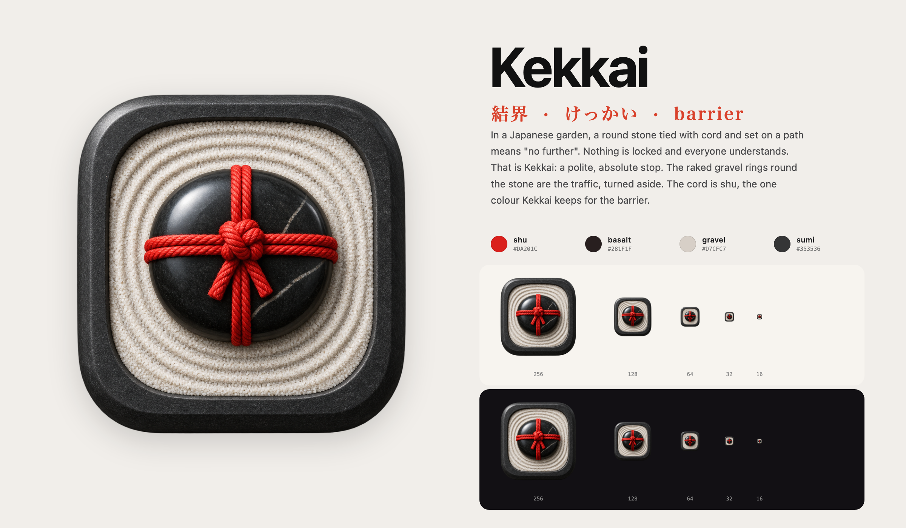
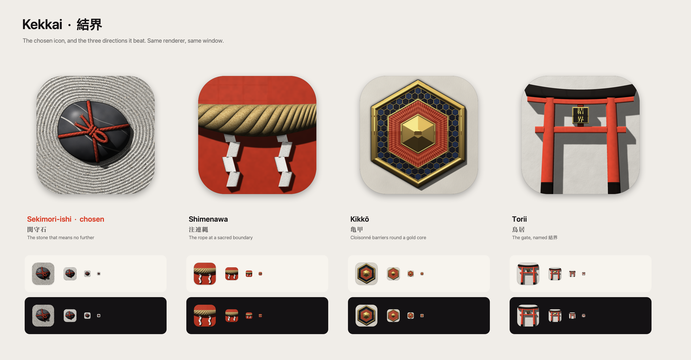

# Kekkai brand

**Kekkai helps people who want to know what their Mac talks to stop the connections they did not ask for, represented by a sekimori-ishi: the garden stone tied with cord that means "no further".**



## The icon: Sekimori-ishi (関守石)

In a Japanese garden, a round stone tied with cord and set on a path tells you not to go on. Nothing is locked, and everyone understands. That is what Kekkai does: a polite, absolute stop. The raked gravel rings round the stone are the traffic, turned aside.

| Decision | Choice |
|---|---|
| Meaning | A barrier that is respected rather than forced: the firewall's verdict, made physical |
| Silhouette | A dark stone with a red cross on pale gravel. Still reads at 16 px |
| Materials | River basalt (dominant), shu cotton cord, shirakawa granite gravel |
| Colour | Shu (`#D9412B`) only on the cord: DESIGN.md keeps shu for the barrier. Everything else is ink and stone |
| Signature detail | The knot: three binding turns, a handle loop that stands up and casts its shadow, two cut tails frayed at the ends |

What makes it real, in the order it was built:

- **Stone.** River basalt with broad mottling, a quartz vein with a thinner one beside it, faint pitting, and a satin sheen that shows the shoji window on its shoulder.
- **Cord.** Cotton dyed shu, laid as a real two-ply twist in the cord's own coordinates, so the lay and the fibres turn with it. It is deep in the lay and bright on each ply, with stray fibres standing off it. The ends are cut and splayed.
- **Gravel.** Raked by hand: the rings wander, come in passes of five teeth with slightly different depths, and bunch where the raker closed the circle. The gravel rises in a small berm against the stone. Grains of white feldspar, grey quartz and beige, the odd larger pebble and a fleck of biotite.
- **Light.** One window high to the left. Shadows are marched over the height field and soften with distance, so the handle loop throws a crisp shadow near the knot and the stone a soft one on the gravel.

Detail by size: 256 px and up get everything. 128 px keeps the binding and the handle loop but drops the tails, fibres, quartz flecks and fine grain. At 64 px and below there is a bigger stone, a thick cross, a single knot and three deep rake rings.

Tokens: shu `#D9412B`, basalt `#3A3B40`, gravel `#E7E3D9`, sumi `#141214`.

## The options it beat



| Option | Object |
|---|---|
| `shimenawa` 注連縄 | A straw rope with zigzag paper shide on a vermilion lacquered beam |
| `kikko` 亀甲 | A hexagonal cloisonné medallion: kikkō cells, translucent shu over a sunburst, a faceted gold core |
| `torii` 鳥居 | A vermilion torii with a 結界 plaque, its shadow on a plaster wall |

## How it is made

**Since 2026-10-21 the app icon is a generated image**, not this renderer's output: the Sekimori stone from [PROMPT.md](PROMPT.md), rendered with an image generator to the standard of Onmitsu and Kuro. `kekkai-icon-master.png` is the original, `kekkai-icon.png` the same object fitted to an 860 px body on a 1024 canvas, which feeds `App/Assets.xcassets/AppIcon.appiconset/`. The renderer below still makes the option sheets; the brand sheet comes from `brand_sheet.py` (text and colours in `brand-sheet.json`, laid out like the renderer's sheet, drawn by headless Chromium).

`scripts/make-icon.swift` is the same height-field renderer as Kagami and Shīru. Nothing is drawn as a gradient, no SF Symbols are used, and 結界 (on the torii option) is rasterised from the Hiragino Mincho outline; no font is shipped. It replaces the earlier flat hexagon from `scripts/render-icon.swift`.

```sh
swiftc -O scripts/make-icon.swift -o /tmp/kekkai-icon
/tmp/kekkai-icon App/Assets.xcassets/AppIcon.appiconset --brand docs/brand   # sekimori by default
```

Passing an `.appiconset` path also writes `Contents.json`. Shared craft standard: [APP_DESIGN.md](../design/APP_DESIGN.md).
